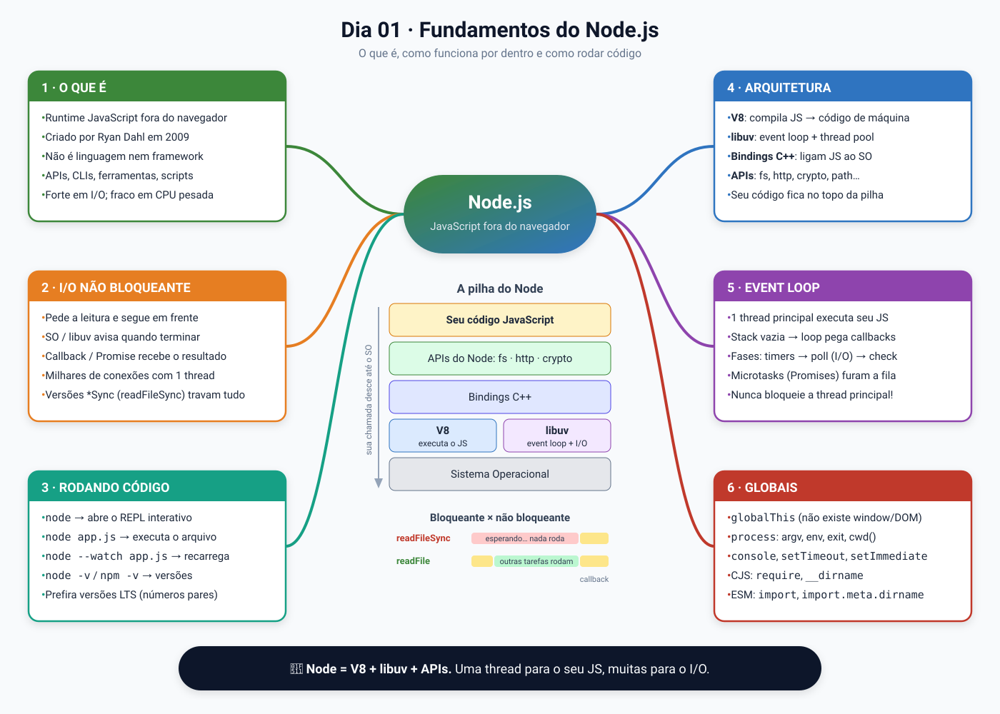
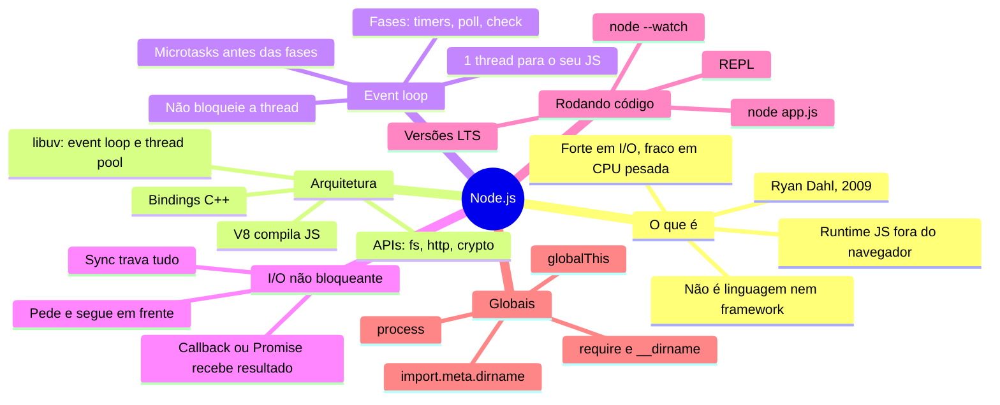

# Dia 01 — O que é Node.js: V8, libuv e a arquitetura

> **Objetivo do dia:** conseguir explicar com suas palavras o que é o Node.js, quais peças formam ele por dentro, por que ele é "single thread" mas aguenta milhares de conexões, e rodar seus primeiros scripts.

## 🔁 Revisão do dia anterior
Primeiro dia — nada para revisar ainda. Amanhã você começa respondendo 3 perguntas sobre hoje.

## 🧠 Mapa mental



<details>
<summary>Versão em texto (Mermaid)</summary>


</details>

---

## 📖 Explicação

### 1. O que é o Node.js
JavaScript nasceu para rodar **dentro do navegador**. Em 2009, Ryan Dahl pegou o motor JavaScript do Chrome (o **V8**) e o colocou para rodar **direto no sistema operacional**, com acesso a arquivos, rede, processos etc. Isso é o Node.js.

- **Não é uma linguagem** — a linguagem é JavaScript (ou TypeScript, que vira JavaScript).
- **Não é um framework** — Express, Fastify, NestJS são frameworks que rodam *sobre* o Node.
- **É um runtime**: o ambiente que executa seu código e te dá APIs (`fs`, `http`, `crypto`…).

**Onde brilha:** APIs/servidores web, microsserviços, ferramentas de linha de comando (o próprio `npm`, Vite, ESLint, TypeScript são feitos em Node), scripts de automação, aplicações em tempo real (chat, websockets).

**Onde não brilha:** trabalho pesado de CPU (processar vídeo, cálculos científicos longos) — porque isso trava a única thread que roda seu JS (veja o item 4). Há soluções (`worker_threads`, Dia 40), mas não é o ponto forte.

> **Navegador vs Node:** os dois rodam JavaScript, mas o navegador te dá `window`, `document`, DOM. O Node te dá `process`, `fs`, `http`. Não existe `document` no Node, e não existe `fs` no navegador.

### 2. A arquitetura: as peças por dentro
Pense em camadas (é o diagrama do meio do mapa):

| Camada | O que faz |
|---|---|
| **Seu código JS** | O que você escreve. |
| **APIs do Node** (`fs`, `http`, `crypto`, `path`…) | Biblioteca padrão escrita em JS. |
| **Bindings C++** | A "ponte" que conecta as funções JS ao código nativo. |
| **V8** | Motor do Google. Compila seu JS para código de máquina em tempo de execução (JIT) e gerencia memória (garbage collector). |
| **libuv** | Biblioteca em C que implementa o **event loop** e o I/O assíncrono. Tem um **thread pool** (4 threads por padrão) para tarefas que o SO não faz de forma assíncrona (ex.: parte do `fs`, `crypto`, DNS). |
| **Sistema operacional** | Quem de fato lê disco, abre sockets etc. |

Resumindo: **Node = V8 (executa o JS) + libuv (cuida do I/O e do loop) + APIs**.

Você pode ver as versões de cada peça com:
```bash
node -p process.versions
```

### 3. I/O não bloqueante
I/O = entrada e saída: ler arquivo, consultar banco, chamar uma API, receber requisição HTTP. Essas operações são **lentas** comparadas à CPU (o processador espera milhões de ciclos por um disco ou pela rede).

- **Modelo bloqueante:** "lê o arquivo e **espera** até terminar". Enquanto espera, nada mais acontece.
- **Modelo não bloqueante (o do Node):** "libuv, lê esse arquivo e **me avisa** quando terminar". O Node segue executando outras coisas; quando a leitura termina, seu **callback** (ou Promise) é chamado com o resultado.

```js
const fs = require('node:fs');

console.log('A');
fs.readFile('dados.txt', 'utf8', (erro, conteudo) => {
  console.log('C', conteudo); // roda depois
});
console.log('B');
// Saída: A, B, C
```

Por isso um único processo Node consegue atender **milhares de conexões simultâneas**: enquanto uma requisição espera o banco, ele atende outras.

⚠️ As versões `*Sync` (`readFileSync`, `writeFileSync`…) são **bloqueantes**. Use-as só em scripts simples ou na inicialização do programa — nunca dentro do tratamento de uma requisição de servidor.

### 4. Single thread e o event loop (visão geral)
Seu código JavaScript roda em **uma única thread** (a thread principal). Quem permite que ela faça "várias coisas ao mesmo tempo" é o **event loop**:

1. O Node executa todo o código síncrono do seu arquivo (call stack).
2. Operações assíncronas são entregues à libuv/SO.
3. Quando a call stack fica vazia, o event loop verifica se há callbacks prontos e os executa, um por vez, passando por **fases**: `timers` (setTimeout/setInterval) → `poll` (I/O) → `check` (setImmediate) → … e repete.
4. Entre uma coisa e outra, roda as **microtasks**: primeiro `process.nextTick`, depois `Promise.then`.

**Regra de ouro:** se um callback demora (um `while` pesado, um `JSON.parse` gigante), o loop inteiro para e nenhum outro usuário é atendido. **Não bloqueie a thread principal.** (Veja `exemplos/04-bloqueando-o-loop.js`.)

> O event loop é tão importante que o Dia 02 é inteiro sobre ele, com as fases em detalhe.

### 5. Rodando código
```bash
node -v                 # versão do Node
npm -v                  # versão do npm (vem junto)
node                    # abre o REPL (digite JS e veja o resultado; .exit para sair)
node app.js             # executa um arquivo
node --watch app.js     # reexecuta automaticamente quando você salva
node -e "console.log(1 + 1)"  # executa um trecho direto
```

**Versões:** o Node lança uma versão principal a cada 6 meses. As de **número par** viram **LTS** (Long Term Support — suporte por ~3 anos). Em produção e para estudar, use uma LTS. Para alternar versões facilmente, use um gerenciador como `nvm` ou `fnm`.

**Bônus TypeScript:** versões recentes do Node (22.18+) executam arquivos `.ts` simples diretamente, apenas **removendo os tipos** — sem checá-los. Teste em `exemplos/05-ola.ts`. A checagem de tipos de verdade é com o `tsc` (Dia 11).

### 6. Globais importantes
| Global | Para que serve |
|---|---|
| `globalThis` | O objeto global (no Node, `global` também funciona). Não existe `window`. |
| `process` | Informações e controle do processo: `process.argv` (argumentos), `process.env` (variáveis de ambiente), `process.exit(código)`, `process.cwd()` (pasta atual). |
| `console` | `log`, `error`, `table`, `time`/`timeEnd`… |
| `setTimeout`, `setInterval`, `setImmediate` | Agendam callbacks no event loop. |
| `require`, `module`, `__dirname`, `__filename` | Existem nos arquivos **CommonJS** (`.js` padrão / `.cjs`). |
| `import`, `import.meta.dirname`, `import.meta.filename` | Equivalentes nos arquivos **ES Modules** (`.mjs` ou `"type": "module"`). |

> CommonJS vs ES Modules é o tema do Dia 03.

---

## 💻 Código
Todos os exemplos estão em [`exemplos/`](./exemplos). Entre na pasta e rode cada um:

| Arquivo | O que mostra |
|---|---|
| `01-ola-node.js` | Versões do Node/V8/libuv, `process.argv`, `cwd`, `__dirname`, ausência de `window`. |
| `02-bloqueante-vs-nao-bloqueante.js` | `readFileSync` vs `readFile` e a ordem de execução. |
| `03-ordem-de-execucao.js` | Síncrono → `nextTick` → Promise → `setTimeout` → `setImmediate`. **Tente prever antes de rodar!** |
| `04-bloqueando-o-loop.js` | Um timer de 100ms que demora 2s porque a thread foi bloqueada. |
| `05-ola.ts` | Rodando TypeScript direto no Node (type stripping). |

```bash
cd dias/01-fundamentos-node/exemplos
node 01-ola-node.js SeuNome
```

## 🏋️ Exercícios
1. **REPL:** abra `node`, digite `process.platform`, `process.version`, `2 ** 10` e `typeof window`. Saia com `.exit`.
2. **Argumentos:** crie `soma.js` que recebe números pela linha de comando e imprime a soma. Ex.: `node soma.js 2 3 5` → `10`. *(Dica: `process.argv.slice(2)` e `Number`)*
3. **Variáveis de ambiente:** crie `saudacao.js` que imprime `Olá, ${process.env.NOME}`. Rode com `NOME=Ana node saudacao.js`. O que acontece se não passar `NOME`? Trate esse caso.
4. **Previsão:** sem rodar, escreva a ordem de saída deste código. Depois rode e confira:
   ```js
   setTimeout(() => console.log('a'), 0);
   Promise.resolve().then(() => console.log('b'));
   console.log('c');
   process.nextTick(() => console.log('d'));
   ```
5. **Bloqueio:** altere `04-bloqueando-o-loop.js` para o loop pesado durar 5 segundos e adicione um `setInterval` que imprime `tick` a cada 500ms. Observe: quantos `tick` aparecem durante o loop?
6. **Watch mode:** rode `node --watch 01-ola-node.js`, edite a mensagem e salve. Veja o recarregamento automático.

## ❓ Quiz
1. Node.js é uma linguagem, um framework ou um runtime?
2. Qual a função do V8? E da libuv?
3. Se o Node roda o JS em uma única thread, como ele atende várias requisições ao mesmo tempo?
4. Por que usar `readFileSync` dentro de uma rota de servidor é uma má ideia?
5. Qual roda primeiro: `Promise.then` ou `setTimeout(..., 0)`? Por quê?
6. O que é uma versão LTS e como identificá-la?
7. Qual global substitui o `window` no Node? E qual dá acesso aos argumentos da linha de comando?
8. Para que tipo de tarefa o Node **não** é a melhor escolha?

<details>
<summary>Respostas</summary>

1. **Runtime** — um ambiente que executa JavaScript fora do navegador e fornece APIs de sistema.
2. **V8** compila e executa o JavaScript (e gerencia memória). **libuv** implementa o event loop, o I/O assíncrono e o thread pool.
3. Com **I/O não bloqueante + event loop**: as operações lentas são delegadas ao SO/libuv; enquanto esperam, a thread atende outras coisas, e os callbacks são executados quando os resultados ficam prontos.
4. Porque é **bloqueante**: enquanto o arquivo é lido, a thread principal para e nenhuma outra requisição é atendida.
5. **`Promise.then`**, porque é uma **microtask** e as microtasks rodam assim que a call stack esvazia, antes de o event loop seguir para a fase de timers.
6. Long Term Support: versão com suporte estendido (~3 anos). São as versões principais de **número par**.
7. `globalThis` (ou `global`). Os argumentos ficam em `process.argv`.
8. Tarefas **intensivas de CPU** e longas (processamento de vídeo/imagem, cálculos pesados), pois travam a thread principal.

Exercício 4: `c`, `d`, `b`, `a`.
</details>

## 📝 Resumo em 5 linhas
1. Node.js é um **runtime** que roda JavaScript fora do navegador, com acesso a arquivos, rede e processos.
2. Por dentro: **V8** executa o JS, **libuv** cuida do event loop e do I/O, **bindings C++** fazem a ponte, e as **APIs** (`fs`, `http`…) ficam por cima.
3. Seu JS roda em **uma thread**; o I/O é **não bloqueante** e os resultados voltam via callbacks/Promises pelo **event loop**.
4. **Nunca bloqueie a thread principal** — evite `*Sync` em servidores e CPU pesada no loop.
5. Rode com `node arquivo.js`, use `--watch` no desenvolvimento, prefira versões **LTS** e conheça os globais `process` e `globalThis`.
