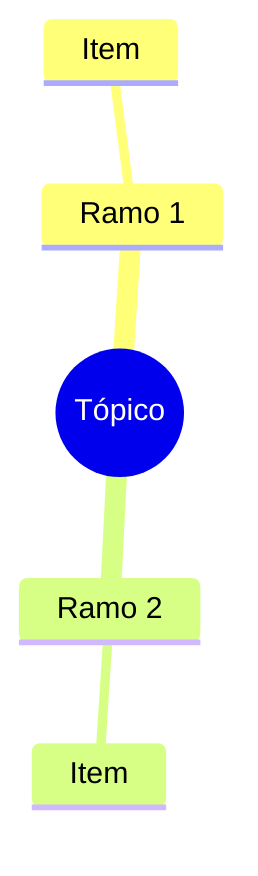

# Dia NN — Título do tópico

> **Objetivo do dia:** uma frase dizendo o que você vai saber fazer/explicar ao final.

## 🔁 Revisão do dia anterior
1. Pergunta rápida
2. Pergunta rápida
3. Pergunta rápida

## 🧠 Mapa mental

Versão em texto (Mermaid)

## 📖 Explicação
### 1. ...
### 2. ...

## 💻 Código
Exemplos em [`exemplos/`](./exemplos).

## 🏋️ Exercícios
1. ...

## ❓ Quiz
1. Pergunta?

Respostas

1. Resposta.

## 📝 Resumo em 5 linhas
1. ...
